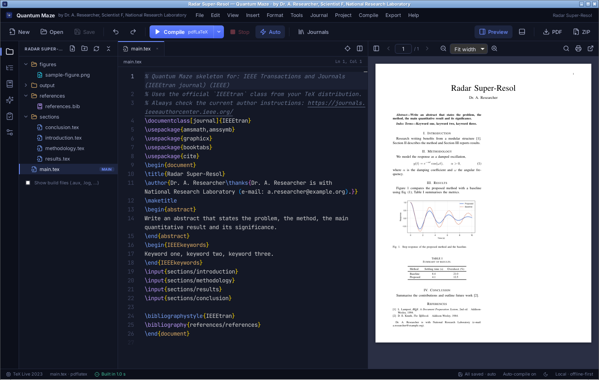
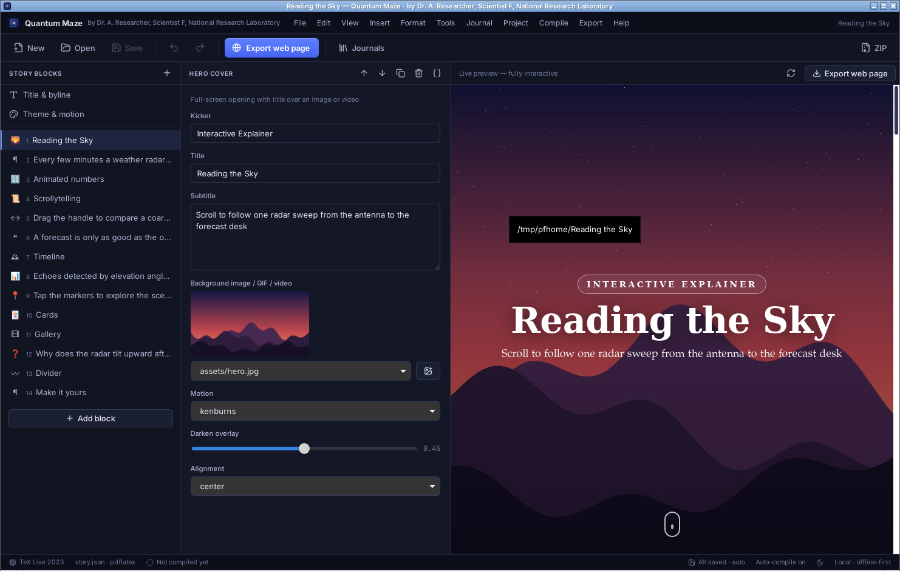

# Quantum Maze – Research & LaTeX Studio

A local desktop studio for research writing. Write and compile LaTeX papers, start from journal formats, build Beamer presentations and export them to PowerPoint, publish interactive scrolling stories as web pages, convert between Word and LaTeX, and assemble submission packages. Projects are ordinary folders on your computer. No account, no upload, no telemetry.

The title bar and welcome screen show "Quantum Maze by *name, rank, organization*" from the profile you enter on first run (Settings → Profile).

Status: version 0.3.0. Built and tested on Linux. Windows and macOS builds are configured but have not been run. See [DEVELOPMENT_STATUS.md](DEVELOPMENT_STATUS.md) for exactly what is verified and what is not, and [ARCHITECTURE.md](ARCHITECTURE.md) for the design.



## What it does

| Area | Features |
| --- | --- |
| Papers | Monaco editor with LaTeX completion, outline, split view · pdfLaTeX, XeLaTeX, LuaLaTeX via latexmk or direct passes · BibTeX and Biber · PDF preview with SyncTeX both ways · errors with file, line and a suggested fix |
| Journal formats | Library of 26 formats (IEEE, Elsevier, Springer Nature, ACM, APS, MDPI, DRDO journals and others) · projects from the official class in your TeX distribution · import a publisher's template ZIP · import any Overleaf/ZIP project |
| Authoring | Table designer (merge cells, booktabs, longtable) · equation editor with live preview · figure and sub-figure insertion · reference list with cited/uncited checks · add a reference by DOI (opt-in) |
| Presentations | Beamer starter with 10 themes and 10 colour schemes · slide list · full-screen presenter with timer · export to `.pptx` (exact picture slides or editable text slides) |
| Interactive stories | 15 block types (hero, scrollytelling, animated counters, timeline, gallery, flip cards, before/after slider, chart, image hotspots, quiz, video…) · 6 colour presets · **26 ready-made templates** (6 layouts such as place guide, news explainer, data story, profile, photo essay and project report, plus 20 long explainers on aviation, drones, instruments, AI image processing, computer vision, VLSI, embedded systems, IoT, LLMs, agentic AI, Linux, data security, cryptography, ethical hacking, drone forensics, wireless sensor networks, radio, SDR, cognitive radio and quantum computing) · save any story as your own template and share it as a ZIP · export as one self-contained HTML file or a web folder |
| Word | LaTeX → `.docx` and `.docx` → structured LaTeX project through Pandoc, each with a conversion report listing what needs manual attention |
| Submission | Checklist against the chosen journal profile · submission ZIP with sources, `.bbl`, final PDF and a SHA-256 manifest |



## Requirements to run

A TeX distribution. Quantum Maze does not bundle or install one; the setup wizard detects what you have.

- **Windows:** MiKTeX or TeX Live. latexmk on MiKTeX also needs Perl (optional; Quantum Maze runs the passes itself without it).
- **macOS:** MacTeX, or BasicTeX plus the packages you need.
- **Linux (Debian/Ubuntu):** `sudo apt install texlive-latex-extra texlive-xetex texlive-luatex texlive-bibtex-extra texlive-publishers biber latexmk`

Optional: **Pandoc** for Word conversion (`sudo apt install pandoc`, or pandoc.org). Without it the Conversion Centre explains what is missing; everything else works.

## Install

Download the installer for your system from the [latest release](https://github.com/batraamul/Quantum_Maize/releases/latest) (or, for any build, from **Actions → build → Artifacts**). Then install a TeX distribution if you don't have one — Quantum Maze uses it but does not include it.

The builds are not code-signed, so Windows and macOS show a warning the first time. That is expected; the steps below get past it.

### Windows 10/11

1. Download `Quantum.Maze_0.2.0_x64-setup.exe` (or the `.msi` if your IT department prefers MSI packages).
2. Run it. If **"Windows protected your PC"** appears, click **More info → Run anyway**.
3. Install a TeX distribution: **MiKTeX** (miktex.org, set "Install missing packages on the fly" to *Yes*) or **TeX Live** (tug.org/texlive).
4. Optional, for Word conversion: **Pandoc** (pandoc.org/installing.html).
5. Start Quantum Maze from the Start menu. The setup wizard finds MiKTeX/TeX Live; if not, point it at the TeX `bin` folder.

### macOS 11 or later (Apple Silicon and Intel)

1. Download `Quantum.Maze_0.2.0_universal.dmg`, open it and drag **Quantum Maze** to **Applications**.
2. The first time, macOS may say the app "cannot be opened because the developer cannot be verified" or "is damaged". Either right-click the app → **Open** → **Open**, or run once in Terminal:
   `xattr -dr com.apple.quarantine "/Applications/Quantum Maze.app"`
3. Install **MacTeX** (tug.org/mactex) — or BasicTeX plus the packages you need.
4. Optional: `brew install pandoc` for Word conversion.

### Linux (x86-64)

| Distribution | Command |
| --- | --- |
| Debian, Ubuntu, Mint | `sudo apt install ./Quantum.Maze_0.2.0_amd64.deb` |
| Fedora, RHEL, openSUSE | `sudo dnf install ./Quantum.Maze-0.2.0-1.x86_64.rpm` |
| Any other | `chmod +x Quantum.Maze_0.2.0_amd64.AppImage && ./Quantum.Maze_0.2.0_amd64.AppImage` (needs `libfuse2`; otherwise prefix with `APPIMAGE_EXTRACT_AND_RUN=1`) |

TeX and tools on Debian/Ubuntu:

```bash
sudo apt install texlive-latex-extra texlive-xetex texlive-luatex texlive-bibtex-extra texlive-publishers biber latexmk pandoc
```

Fedora: `sudo dnf install texlive-scheme-medium latexmk biber pandoc`. Ubuntu 22.04's Pandoc (2.9) works but cannot format citations in LaTeX → Word; install a current Pandoc from pandoc.org for that.

### Uninstall

Windows: Settings → Apps. macOS: drag the app to the Bin. Linux: `sudo apt remove quantum-maze` / `sudo dnf remove quantum-maze`, or delete the AppImage. Settings stay in the per-user data directory (shown in Settings → About); your projects are never touched.

### Building installers yourself

Every push to `main` builds all platforms on GitHub Actions (`.github/workflows/build.yml`) and, when the build succeeds, publishes them as the GitHub Release `v<version>` (version taken from `package.json`; bump it for a new release). To sign the macOS build, add the `APPLE_*` repository secrets listed in the workflow.

## Using the journal library

Open it with **Ctrl+Shift+J**. Each entry is labelled by where its format comes from:

- **official · ready** — the publisher's document class is already in your TeX distribution (for example `IEEEtran`, `elsarticle`, `acmart`). Quantum Maze writes a starter `main.tex` that uses it.
- **official · needs download** — the publisher distributes a ZIP (for example IEEE Access, MDPI). Use the *Template download page* button, download the ZIP yourself, then *Import downloaded ZIP*. Quantum Maze never redistributes publisher files.
- **community** — the journal publishes no LaTeX template (for example the Defence Science Journal, which takes Word). The layout is a draft built from the author guidelines; convert to Word for submission.
- **unverified** — the entry's links could not be checked when the registry was written. Confirm on the publisher's site.

Indexing (SCI/SCIE, Scopus…) is shown as "Not verified" until you record it yourself with a source and date. Quantum Maze does not infer indexing from open-access status or anything else.

## Story templates

New Project → Interactive story shows a searchable gallery. Templates are starting points: every text, number and picture can be changed. All bundled artwork is generated by code and free to reuse; replace it with your own photographs and diagrams. Facts in the topic templates were written in November 2026; check them against a current source before publishing.

- **Save as template** (Story Studio toolbar or Export menu) adds the current story to your own templates.
- **Export** in the gallery writes a template ZIP; colleagues add it with **Import template…**. Imported ZIPs are checked: only `story.json`, `template.json` and media files under `assets/` are kept.
- Developers add bundled templates by editing `tools/story_templates/content_*.py` or `formats.py` and running `python3 tools/story_templates/build.py`.

## Develop

Prerequisites: Node 20+, Rust stable, and the [Tauri 2 system dependencies](https://tauri.app/start/prerequisites/) for your platform.

```bash
npm install
npm run tauri dev            # run with hot reload
npm test                     # frontend unit tests
cd src-tauri && cargo test   # backend unit + integration tests (uses your TeX install, Pandoc, LibreOffice when present)
npm run tauri build          # release build and installers for the current platform
```

## Keyboard

| Action | Shortcut |
| --- | --- |
| Compile | Ctrl+Enter |
| Stop compilation | Ctrl+Shift+. |
| Save / Save all | Ctrl+S / Ctrl+Shift+S |
| Journal library | Ctrl+Shift+J |
| Insert table / equation / figure | Ctrl+Alt+T / Ctrl+Alt+E / Ctrl+Alt+F |
| Present slides | F5 |
| Show cursor position in PDF | Ctrl+Alt+J |
| Jump from PDF to source | Double-click in the preview |
| Bold / italic | Ctrl+B / Ctrl+I |
| Toggle preview / output / sidebar | Ctrl+Alt+P / Ctrl+J / Ctrl+Alt+B |

On macOS, Ctrl is ⌘.

## Safety and privacy defaults

- Nothing is sent over the network unless you turn on *Allow online services* (Settings → Privacy). The only online feature is DOI lookup, which sends the DOI to doi.org and nothing else.
- Shell escape is disabled; it can be enabled per project after a warning.
- A `latexmkrc` inside a project is ignored, and scripts inside imported archives are never run.
- Imported ZIPs are extracted into a private staging folder with path-traversal, symlink, size and compression-ratio limits before anything is copied.
- TeX can only write inside the project folder.
- Deleting a file moves it to `.qmaze/trash/` in the project. Overwrites are snapshotted to `.qmaze/history/`.
- If another program changes a file you have open, Quantum Maze reloads it (when you have no unsaved edits) or asks which version to keep. It never overwrites the changed file silently.
- Conversions and exports write new files; the source document is never modified.

## License

MIT for Quantum Maze's own code. Third-party components keep their licenses (Tauri: MIT/Apache-2.0, Monaco Editor: MIT, PDF.js: Apache-2.0, KaTeX: MIT, Inter and JetBrains Mono: OFL-1.1). Publisher document classes and templates belong to their publishers and are not included.
